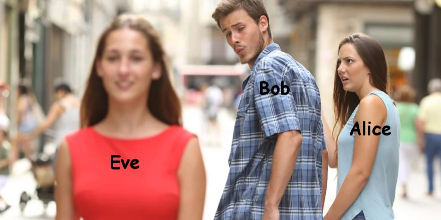

# Cryptography 2

## Going further: transposition, XOR, and breaking RSA



---

# Recap: Week 1

Week 1 covered the basics, all of which [CyberChef](https://gchq.github.io/CyberChef/) handles:

- Caesar and ROT13 (classical substitution)
- Hashing (MD5, SHA) and the idea of cracking it
- Encodings (Base 2 / 16 / 32 / 64 ...)

Today we go further: rearranging instead of substituting, XOR done properly, and
breaking schemes that are supposed to be secure.

---

# Transposition ciphers

A substitution cipher swaps letters for other symbols.

A **transposition** cipher keeps the same letters and just **rearranges their order**.

The giveaway: the letter frequencies still look like normal English, but the text is
unreadable. If an anagram of the ciphertext spells something, it is transposition.

---

# Transposition: rail fence

Write the message in a zig-zag over 3 rails, then read each row left to right.

Plaintext: `BRINGHELP`

| 1 | 2 | 3 | 4 | 5 | 6 | 7 | 8 | 9 |
| - | - | - | - | - | - | - | - | - |
| B |   |   |   | G |   |   |   | P |
|   | R |   | N |   | H |   | L |   |
|   |   | I |   |   |   | E |   |   |

Reading each row: `BGP` + `RNHL` + `IE` = `BGPRNHLIE`

To solve: try a few rail counts in CyberChef (*Rail Fence Cipher Decode*), or feed the
letters to an anagram solver.

---

# More rotation: ROT47

ROT13 only rotates the 26 letters A-Z. Punctuation, digits and symbols pass straight
through.

**ROT47** rotates the whole printable-ASCII range (`!` to `~`, 94 characters), so digits
and symbols get scrambled too.

```
Plaintext:   Gate 7 opens at 0300!
ROT47:       v2E6 f @A6?D 2E _b__P
```

Recognise it by the soup of symbols. Decode with CyberChef *ROT47* (amount 47).

---

# Numbers for letters: A1Z26

Sometimes letters are just their position in the alphabet: A=1, B=2 ... Z=26.

```
8 5 12 12 15   =   H E L L O
```

A run of numbers all between 1 and 26 is the tell. CyberChef *A1Z26 Decode*.

---

# Symmetric encryption: XOR

Same key encrypts and decrypts. XOR each plaintext byte with a key byte; repeat the key
to cover the whole message.

```
foo XOR bar:
  01100110 01101111 01101111
  01100010 01100001 01110010
= 00000100 00001110 00011101
```

Decrypting is the same operation again with the same key.

---

# Breaking repeating-key XOR

One message, one short repeating key. You can still break it with no key at all.

1. **Find the key length.** The key repeats, so identical plaintext chunks encrypt the
   same way at a fixed spacing (Kasiski). Repeated bytes sit at distances that are
   multiples of the key length.
2. **Recover the key.** Guess a likely word (a "crib") such as a common word or a space,
   XOR it along the ciphertext, and when a **repeating fragment** falls out you have found
   both the position and the key.

CyberChef *XOR Brute Force* automates the short-key case.

---

# XOR key reuse

Reusing one key across different messages is fatal. XOR has these rules:

```
(a XOR b) XOR c = a XOR (b XOR c)
a XOR a = 0
a XOR 0 = a
```

So given plaintext `m` and ciphertext `k XOR m`:

```
(m XOR k) XOR m = (m XOR m) XOR k = k
```

Known plaintext leaks the key directly.

---

# Password cracking

Back to hashing, as promised. Hashes are one-way, so you do not reverse them, you
**guess and check**.

- The hash **length** tells you the algorithm: 32 hex = MD5, 64 = SHA-256, 128 = SHA-512.
- Hash millions of candidate passwords, compare to the target.
- `rockyou.txt` is the classic wordlist (14 million leaked passwords).

```
john --wordlist=rockyou.txt hashes.txt
hashcat -m 0 hashes.txt rockyou.txt      # -m 0 = MD5
```

---

# Asymmetric encryption: RSA

Two keys. Encrypt with the **public** key `(n, e)`, decrypt with the **private** key `d`.

```
n = p*q            (public modulus)
phi = (p-1)(q-1)
d = e^-1 mod phi   (private)
```

Security rests entirely on `n` being too big to factor. Make `n` small and the whole
thing falls apart.

---

# Breaking textbook RSA: factor small n

The private key is not an independent secret. It is **determined by the factors of n**.

```
n = 2773  ->  factor:  n = 47 * 59
phi = 46 * 58 = 2668
d = 17^-1 mod 2668
```

Extended Euclid:

```
2668 = 17*156 + 16
  17 = 16*1  + 1
  => 1 = 17*157 - 2668   ->   d = 157
```

You rebuilt the private key from the public values alone.

---

# Textbook RSA is just a substitution

Encrypting one character at a time with no padding is **deterministic**: the same letter
always gives the same number.

```
"meet"  ->  170, 758, 758, 2504
             m    e    e    t
                  repeated 'e' -> repeated 758
```

Equal numbers mean equal letters, so frequency analysis cracks it with no key. And with
`n` small, every character is just `m^e mod n` for `m` in 0..255, so you can brute the
lot.

---

# Digital signatures: DSA

A signature proves a message came from the holder of a private key `d`.

```
r = (g^k mod p) mod q        (depends only on the nonce k)
s = k^-1 (H(m) + d*r) mod q
```

`k` is a **nonce**: a fresh random number for every signature. It must never repeat.

---

# Attack: nonce reuse

If `k` repeats, `r` repeats (it only depends on `k`). Two signatures with the **same r**
means the same nonce.

```
p=983  q=491  g=4   public key y=450
msg1: H=88  (r=135, s=303)
msg2: H=55  (r=135, s=482)   <- same r!
```

```
k = (H1 - H2) / (s1 - s2)  mod q  = 222
d = (s1*k - H1) / r        mod q  = 123     (check: g^d mod p == y)
```

Both divisions are modular inverses, exactly like deriving `d` in RSA.

---

# This really happens

- **PlayStation 3** (2010): Sony reused the same nonce for every code signature, so
  `fail0verflow` recovered the console's master signing key.
- **Bitcoin / Android wallets** (2013): a weak random number generator reused nonces and
  let attackers steal private keys, and the coins they protected.

A single repeated number is enough.

---

# luhack.uk/w5

Put it into practice: [quiz.luhack.uk/w/code-crackers-2/](https://quiz.luhack.uk/w/code-crackers-2/)

[GCHQ CyberChef](https://gchq.github.io/CyberChef/)
